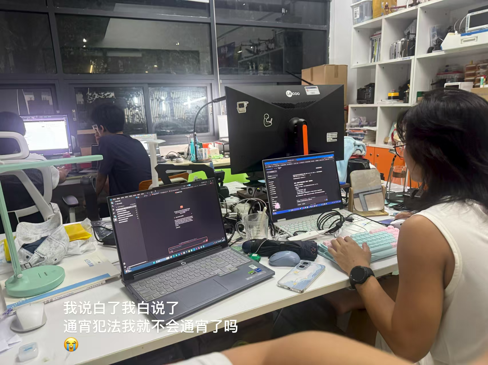
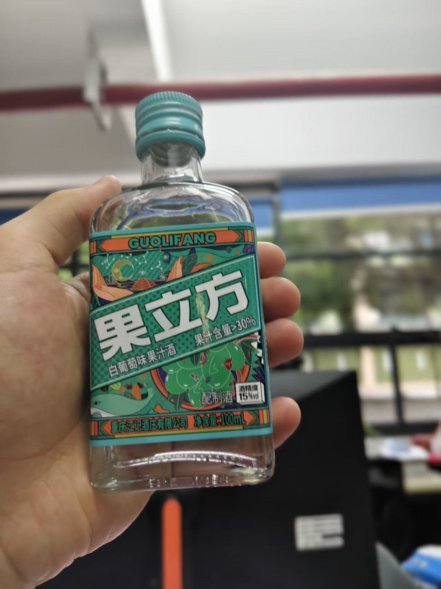
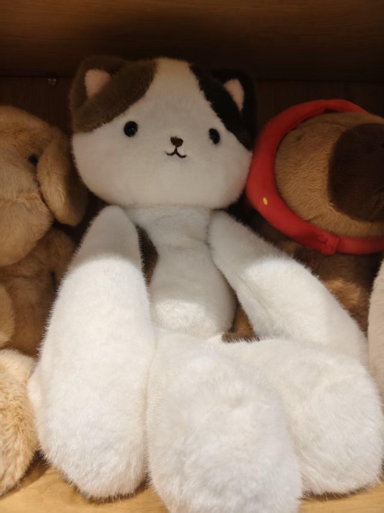
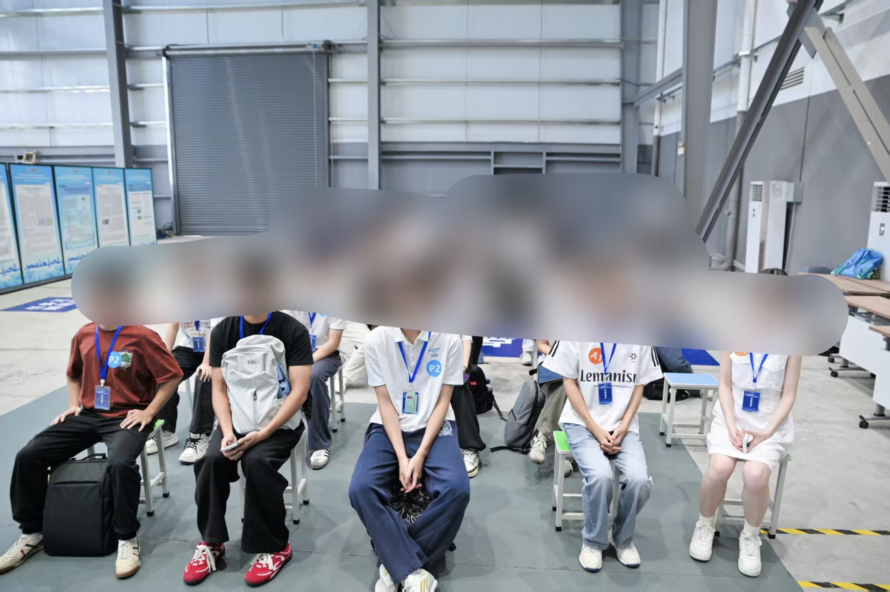
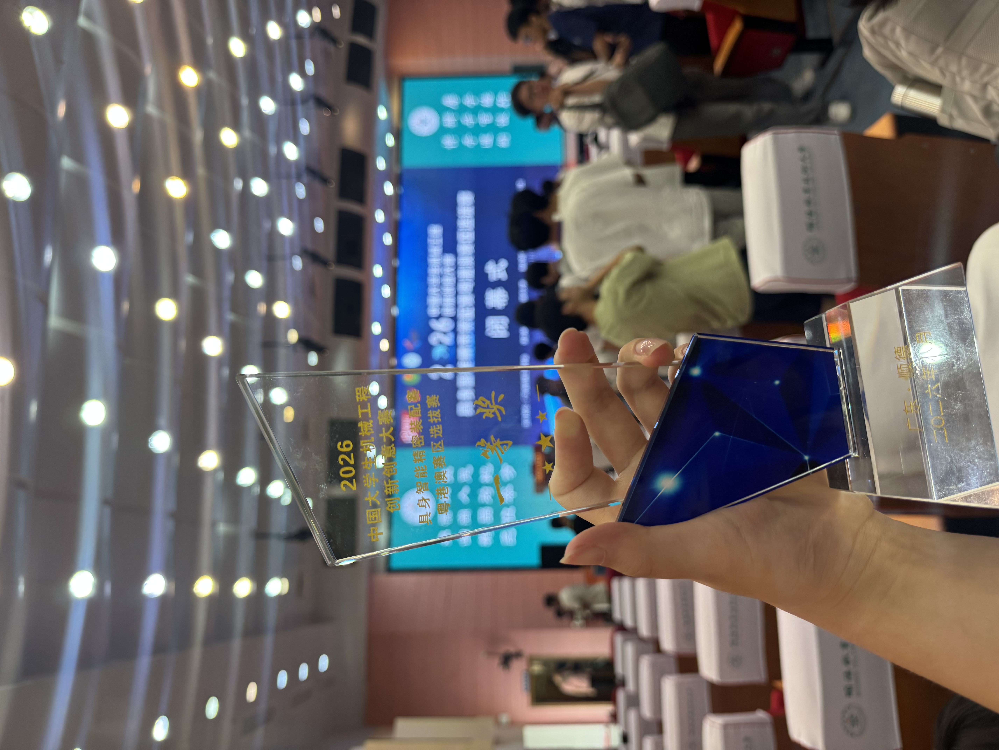

# 省赛

## 赛前情况

一点都没有为电赛坠机而感到悲伤，紧接着赶来的是五月初就决定好要参加的**具身智能-精密装配大赛**！老实说，我一开始心里是很没底的。因为无论是五月底的培训、亦或是早就发出的任务书，我都是到很晚才去看、去学习的，但是我很相信师兄！所以我在八月初还做学习一些控制相关的理论亦或是实践知识...... 总之拖到了我觉得：“不行，再这样下去我的道德会狠狠谴责我的！“的时候。

### 第一次实测

我在8号才安装好比赛要用的软件，9号大家才陆续来到工作室，看到队长在大致分配每个人都该干什么，我心里才有一点实感：如果再不分配任务开工的话，肯定会来不及的吧！~~当然最后还是没来得及~~

当时的我还想着：8个人，完完全全的劳动力溢出啊！感觉我应该会很轻松呢......总之有点想的太美了，总之，我记得我没被分配什么像样的任务，于是我便去看了看往年的培训视频。其实在这之前，我就有想过，这整个题目需要被分为几步骤，而通信，就是我认为里面最基础的一环。而恰巧，往年的培训视频里面有展示过一个示例的通信脚本，虽然对于当时的我是完全陌生的语言，但是借助了AI的力量，我还是解明了它的意思，像模像样的写了一版通信脚本，用于实现示教器与上位机的TCP通信。在搞懂这个代码的过程中，我也顺便理解了TCP通信的原理，“看起来我完全弄懂了他们之间的通信！”我如是想到，实现了虚拟机和本机和相机的信息联通。

11号很快就到了，毕竟确实也只有2天时间，下午，我们乘着去往顺德的出租车，来到了顺职大。
但第一次实测，非常糟糕，很长一段时间内，我们连不上相机，连不上语音盒子，说白了，什么都没做到，真是挫败啊！即便很懊恼，但也改变不了现在什么都做不到的现实。即便如此，老学长来时买来了果茶鼓励着我们，老学长，你真的，我哭死！

### 第二次实测

其实感觉除我之外的大家，都没有受到很大的打击，大家好像真的觉得是时间太紧、没准备好导致出现这样的窘境。

就在我想要好好解决一个又一个问题的时候，发生了一件我觉得上大学一年来，最具危机感的一件事情，如果以后有机会的话，我可能会再讲讲吧......

总之，时间跳跃到14号中午，我再次回到了工作室，但让我震惊的是：工作室居然没人！我大受震撼，竞赛的小群里面也没人说话，搞什么啊喂，你们难道不打了？我私信问了一下队长，原来是大家都没空呀，我还以为是默认弃权了呢......

当晚，队长成功召集到了大家，我们开始再一次讨论分工。很不幸的是，我觉得队长想要的实现方案难以实现，我勇敢的去跟队长提出了这件事。但是，呃，队长的解决方案居然是：两条方案一起走......我是在Git上面创造了一个分支吗？我其实有一点不能接受，但是比起去做一个我觉得不可能实现的方案，还是有盼头了很多。总之，这个已经是完全体状态下的阿獭佧，又狠狠干了两天，参悟了 ~~咒力的本源~~ 所有涉及知识点的獭，终于在第二次实测前搓出来了一个勉强能看的方案。

睡眠很不好的来到了第二天的实测，为了让自己打起精神来，买了一个很果的酒

目的地依旧是顺德职业技术大学！

**惨败！** 在规定的调试时间内，根本就没有让我摸到过电脑，呜呜呜呜，我真的生气了，明天我转手把程序封装给舍友得了（舍友也打同一个比赛）。但是关键点来了，我们是最后一个来测试的，正巧没人来管我们，难道说？

总之，我终于有时间测试我的程序了！**饿啊，又是惨败......** 我的程序也很夸张的失败了。其实就这一段时间之后很搞笑，有的人在耍手机，有的人在睡觉，有的人在谈情说爱，有的人却在想：不应该呀！我这怎么会错呢？

八点多了，距离规定的撤离时间已经晚了一个多小时，我开始坐在角落慢慢的去优化我的程序结构去了。又过了好一会，我拿着改好的程序再倔强的去跑了一遍......

在将第一个方块吸住之后，我惊呼一声！everybaby 都围了上来，难道说？1.2.3.4.5.6，ok！虽然误差好大，但是程序运行没问题！哇塞，台下观众惊喜若狂你们懂吗，柳暗花明又一村你们懂吗，总之，在巨大的动力加持下，我们凌晨两点才准备回广州，真是猎猎又奇奇啊，也是偷了7个小时好吧。

### 第三次实测

在二测后，我压力也是又变大了起来，毕竟是我写的程序，毕竟是我管的视觉，总之补全功能、优化细节、简化流程、操作讲解什么什么的做了一大堆事，好过分啊！怎么什么都让我做......不管怎么抱怨，最后还是在ddl之前把该弄得弄好了。

ok，三顾顺德，但这次不一样，这次有酒店！虽然我觉得很奇怪，怎么会有一家这么高档的酒店，很突兀的出现在学校附近呢？但可惜已经没有保存当时的图片了，所以没法给你们展示了。即便如此，我还是想说：这简直是我住过的最好的酒店！**特特特特特别是那位前台小哥**，我的天哪，你是从模子里走出来的**绅士**吗？他的说话、谈吐、肢体动作、办事方法，都太有感觉了，我也是第一次受到这样的服务，也许我以后可能会再次受到差不多的服务，但是我可能永远不会忘记你了吧......还有这个机器人服务，外卖直接送货上门！太舒服了吧，而且附近的外卖又多又便宜，享受，纯纯的享受啊！

虽然想回归正题，但是来的太早了，还是先出去逛逛街吧！其实对我来说，商业街都是一个样子，来来回回就是那些东西，但是我遇到了一个超级喜欢的大玩偶，就是下面图片，玩偶在60cm以上，超级超级可爱，我记得当时看了看价格，60多，拍了张照想着回去pdd买，结果网上也要50多，所以后面就一直没有去买......

除此之外，没有发生什么特别的事，晚上又完善了操作介绍文档，然后再解决了另一队成员的技术问题后，很美美的进入了梦乡。

OK！第三次实测，我带着超级多的自信，气势磅礴的去进行一个实测。但是又坠机了，坠机的彻底，两队都甚至没来的及跑出运行结果......大家的气氛一下子跌倒谷底，真是糟糕啊。话是这么说，但其实很多只是我自己感受的而已，当晚大家还是正常的Debug、预演~巴拉巴拉......

### 省赛现场

姑且声明一下，你才是挑战者！总之是一份没有省略任何步骤的超质量睡眠，我很成功的在12点醒了。由于比赛时间不同，另一队的比赛感受已经出来了，居然是很让人意外的没有坠机。说实话，他们就是在背我们的操作，能不出问题，我感觉很幸运了。这样压力来到我们这边，从酒店出来、坐车、最终预演、战前打气、超绝等待......

饿啊！等了两个多小时，终于上场了。
是跌宕起伏的比赛过程呀~先是遇到没遇到过的问题！技术人员一秒解决了，然后好光速好光速的把所有要配置的东西弄好了，一看时间，好快！才过去15分钟左右，感觉要吃鸡了呀~！于是我们开始自己跑一遍，没问题！叫裁判，裁判来力！再次启动，机魂不悦，卡卡卡卡，饿~啊，没有在规定时间内跑完任务，伤心欲绝！呜呜呜呜

即使是接受了烷基八氮的事实，我也依旧保持着：“方案没问题，只是卡了，没办法，那没办法了，只好给了”的想法。总之，灰溜溜的没有去参加闭幕式，直接打车准备回广工了。

但在车上，队长打电话过来了：我们是省一！

**真的假的？！**

这真是太魔幻了，明明毫不抱希望、已经坐上了go home的车了的我，居然遇到了这样的反转

ps：奖杯最后因为没人要放到我家里当装饰物了喵~